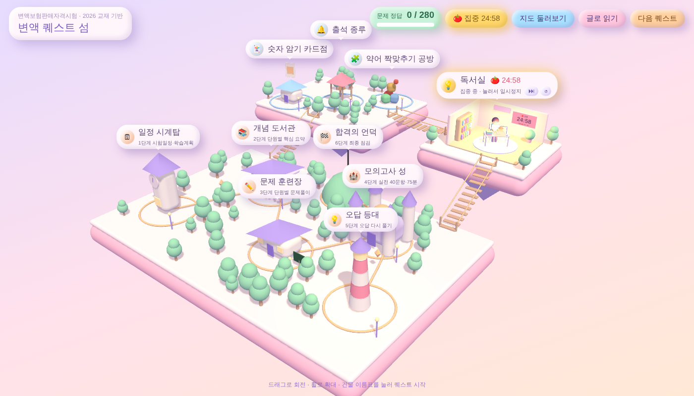

# 변액 퀘스트 섬 (Variable Quest Island)

변액보험판매자격시험을 게임처럼 퀘스트를 깨며 공부하는 3D 학습 사이트예요.

## 사이트
https://bborami.github.io/variable-quest-island/

## 퀘스트
- 🗓 일정 시계탑: 시험 일정과 학습 루트
- 📚 개념 도서관: 단원별 핵심 개념·빈출 유형
- ✏️ 문제 훈련장: 단원별 10문제 풀이·채점·해설
- 🏰 모의고사 성: 40문항 75분 실전 모의고사
- 💡 오답 등대: 틀린 문제 다시 풀기
- 🏁 합격의 언덕: 최종 점검
- 사이드 섬: 숫자 암기 카드 · 매일 5문제 출석 · 약어 짝맞추기
- 📖 독서실: 스탠드 ON/OFF, 뽀모도로 타이머, 같이 공부하는 사람 실시간 표시(Firebase)

진행 기록은 각자 브라우저(localStorage)에 저장돼요.

🔒 문제와 해설은 비밀번호로 암호화되어 있어요. 함께 공부하는 분께 비밀번호를 받아 들어가세요.

## 기술
단일 `index.html` · three.js · Firebase Realtime Database(익명 로그인)
